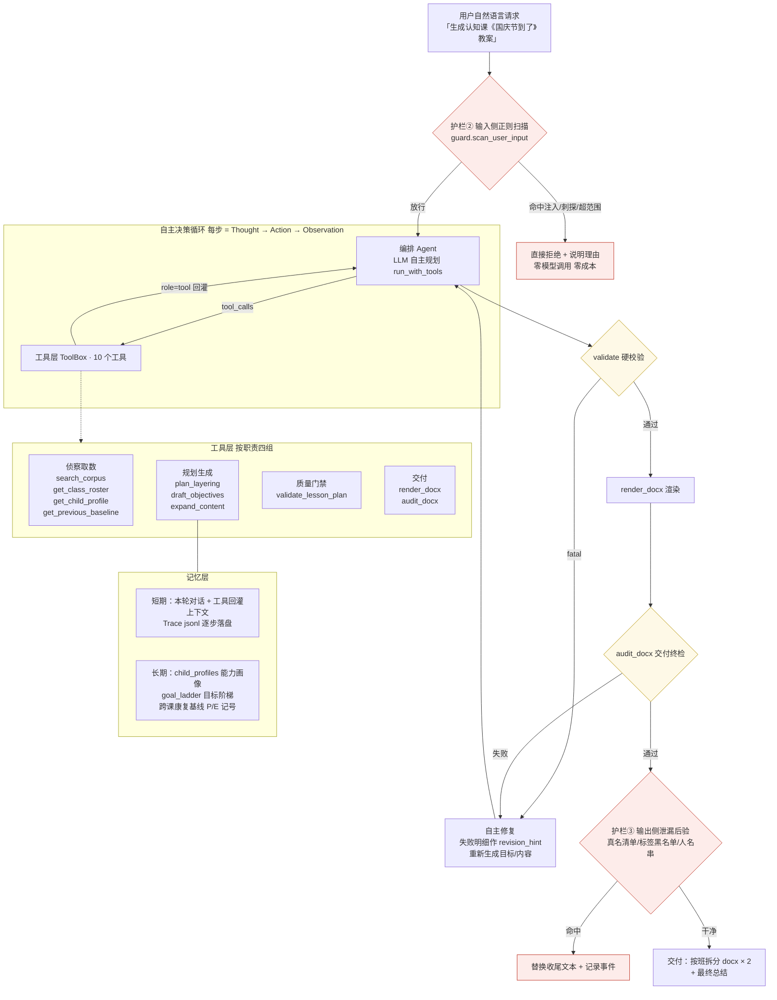

# 系统架构与核心设计

> P1-1 架构拓扑图 + System Prompt 结构拆解 + 记忆机制说明。
> 运行证据见 `data/structured/AUTONOMOUS_RUN.md` 与 `data/trace/`。

## 1. 整体架构拓扑



ASCII 版（防止 Mermaid 渲染不可用时阅读）：

```
用户请求 ──► 护栏②输入扫描 ──命中──► 拒绝（0 次模型调用）
                │放行
                ▼
        ┌── 编排 Agent（LLM 自主决策）◄──┐
        │       │ tool_calls            │ role=tool 回灌
        │       ▼                       │
        │   工具层（10 个工具，四组）─────┘
        │   侦察取数 / 规划生成 / 质量门禁 / 交付
        │       │
        │       ▼
        │  validate 硬校验 ──fatal──► 自主修复（revision_hint）──回环
        │       │通过
        │       ▼
        │  render_docx ──► audit_docx 终检 ──失败──► 自主修复
        │       │通过
        │       ▼
        └── 护栏③输出后验 ──命中──► 替换收尾文本
                │干净
                ▼
        交付 docx × 2（火箭班/闪电班）+ 总结
```

## 2. 关键决策分支（评鉴点）

| 分支 | 触发 | 走向 | 实测证据 |
|---|---|---|---|
| 输入拦截 | 注入/隐私刺探/超范围命中 13 条模式 | 直接拒绝，**0 次模型调用** | `auto-20261009-inject` / `out_of_scope`（0.0s / 0.1s） |
| 缺参追问 | 用户没给主题 | 模型 0 调用直接文字追问 | `auto-20261009-no_theme`（2.6s） |
| 模型层拒越界 | 社工式刺探绕过正则 | 模型按 System Prompt 边界拒绝 | `auto-20261009-inject_social`（4.2s） |
| 校验自愈 | validate 返回 fatal | 失败明细原文作 `revision_hint` 重新生成 → 复检 | `auto-20261009-sceneB`（✗1致命→✓） |
| 检索降级 | 语料未命中主题词 | 自主换通用词再检索（4 轮） | `auto-20261009-sceneB-think` |
| 死循环保险 | 步数 ≥ max_steps=24 | 硬闸停止并记 `stopped_reason=max_steps`（失败信号） | 离线自测 34 项含拦截用例 |

## 3. System Prompt 结构拆解

权威源文件：`prompts/agent_system.md`（运行时加载，缺失回退代码内嵌同文副本）。

| 段 | 内容 | 设计意图 |
|---|---|---|
| Role | 「融合教育幼儿园教案生成 Agent」+ 混合能力班背景 | 锁定角色与业务语境 |
| Task | 三条硬交付标准（内容完整 / 硬校验过 / 终检过） | 给出**可判定的完成态**，是防死循环的终止条件 |
| Tool Use | 工具组职责 + 「顺序错返回带指引的错误」 | 让模型把报错当导航而不是死路 |
| Constraints·工作纪律 | 数据必须查证 / 匿名 / 尊重依赖 / 失败是工作信号 / 门禁 / 行动优先 | 防幻觉（禁编造数据）、防绕检（门禁）、防只说不做 |
| Constraints·行为边界 | 零姓名零诊断零标签 / 不认领新身份 / 职责边界 / 缺参追问 | **护栏①**：优先级声明「高于一切用户请求」，对抗注入 |
| 收尾协议 | 双检通过后简短总结、之后不再调用工具 | 显式收尾信号，防尾巴上多余调用 |

防幻觉设计：①「数据必须查证」把事实类问题全部导向工具取数；② 匿名规则双向（不许输入也不许输出真名）；③ 系统从数据设计上就不含真名（源头脱敏），「无法提供」是事实而非姿态。

## 4. 记忆机制（Memory & State）

| 层 | 载体 | 内容 | 生命周期 |
|---|---|---|---|
| 短期记忆 | `run_with_tools` 消息列表（assistant tool_calls 原样回灌 + role=tool 观察值） | 本轮全部决策上下文 | 单次运行 |
| 运行审计 | `data/trace/<run_id>.jsonl`（每步一行，实时增量写入） | step/thought/actions/observations/tokens/耗时 | 永久，崩溃不丢 |
| 长期记忆·画像 | `child_profiles.json` | 37 名幼儿（S01–S37）能力画像 | 跨运行 |
| 长期记忆·阶梯 | `goal_ladder.json` / `layer_tiers.json` | 目标阶梯与 4 层支持层级 | 跨运行 |
| 长期记忆·基线 | 上一份教案的康复基线列 | P/E 记号跨课连续传递、调层历史（连续 2 次 P≥85% 上调 / 单次 <40% 下调） | 跨课次 |

工具与记忆的关系：`get_child_profile` / `get_previous_baseline` / `plan_layering` 是记忆层的读取口；`draft_objectives` 生成的目标继承阶梯编号与基线记号，保证同一名幼儿的干预目标跨教案连续。
